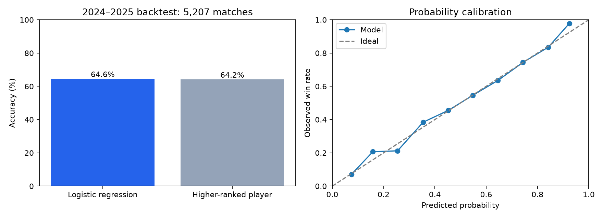

# ATP Tennis Match Prediction

An AI-assisted educational sports analytics project prepared for Sohan Cherukuri.

Predicts individual ATP match outcomes with logistic regression using ranking differences, previous results and surface history. The model is evaluated chronologically, with no random train/test splitting.

## Verified historical backtest

| Model | 2024–2025 accuracy |
|---|---:|
| Logistic regression | 64.59% |
| Always pick higher-ranked player | 64.22% |

Test sample: 5,207 independent matches. Training: 16,572 matches from 2016–2022. Validation: 2,668 matches from 2023. Historical warm-up starts in 2014. The observed gain is small (19 additional correct predictions) and is not evidence of a statistically established advantage.

## Reproduce

Open `ATP_Tennis_Prediction.ipynb` in Google Colab and run all cells on a CPU. It downloads a pinned data snapshot and verifies file hashes. Alternatively, install `requirements.txt`, run `download_data.py`, then `analysis.py` locally. The downloader resolves the current snapshot, so later local downloads may differ from the pinned notebook.

## Method

- Exclude retirements, walkovers, defaults, abandoned matches, team events, unknown surfaces and missing rankings.
- Neutral player ordering is selected deterministically from match identifiers.
- Use log ranking ratios, recent ten-match win-rate differences and historical surface win-rate differences, plus surface/ranking interactions.
- Smooth history rates for players with limited previous observations.
- Tournament start dates are not exact match dates. Withhold each result for 21 days after tournament start before it can affect another match's history.
- Fit scaling on training examples only. Choose regularization using 2023 log loss, then fit on 2016–2023 before the final 2024–2025 evaluation.
- Mirror only training observations to make the model symmetric under player order changes. Test games are each evaluated once.
- The model remains fixed during testing, while historical features can incorporate sufficiently old completed results as time advances.

Log loss: 0.6204. Brier score: 0.2162. The hard-decision ranking baseline is useful for accuracy comparison, but is not a calibrated probability forecast. Historical example outputs are replays, not live predictions.

## Limitations

The 21-day delay sacrifices recency to avoid same/overlapping-tournament information leakage. Tournament-date rankings are assumed available at the tournament start. The modern database may include later corrections and is not a point-in-time archived feed. Coverage is restricted to ranked players in retained completed tour matches. There are no injury, odds, weather or live data inputs. No betting or investment performance is claimed. This is a retrospective evaluation and its test period should not be reused to select further changes.

## Attribution and assistance

Match data: [TennisMyLife TML-Database](https://github.com/Tennismylife/TML-Database), which acknowledges Jeff Sackmann / Tennis Abstract. Source terms permit educational analysis with acknowledgement and restrict commercial use without express permission. Raw data is excluded from the repository. The notebook includes exact download URLs and SHA-256 hashes.

AI assistance was used for coding, debugging, and documentation. It independently implements standard statistical methods. Review the code and reproduce the analysis before describing your personal contribution. Library authors and data collectors retain their respective rights.

